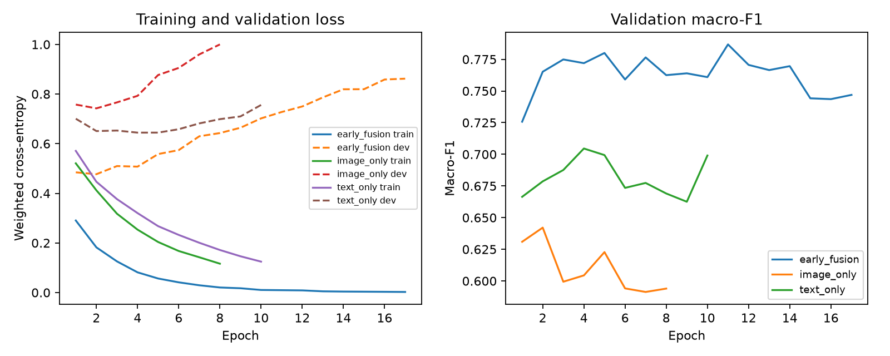
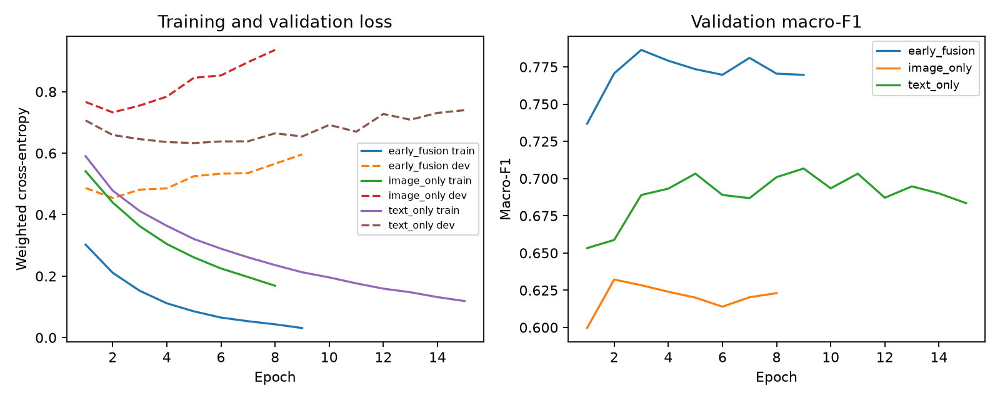
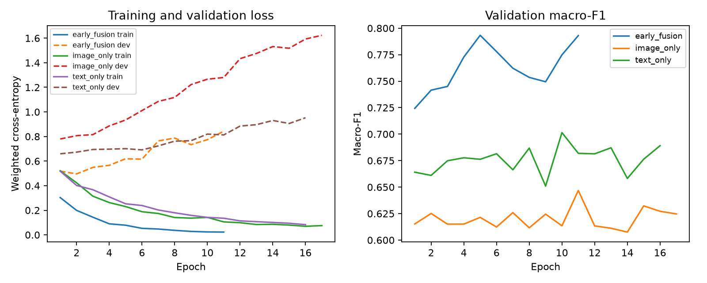
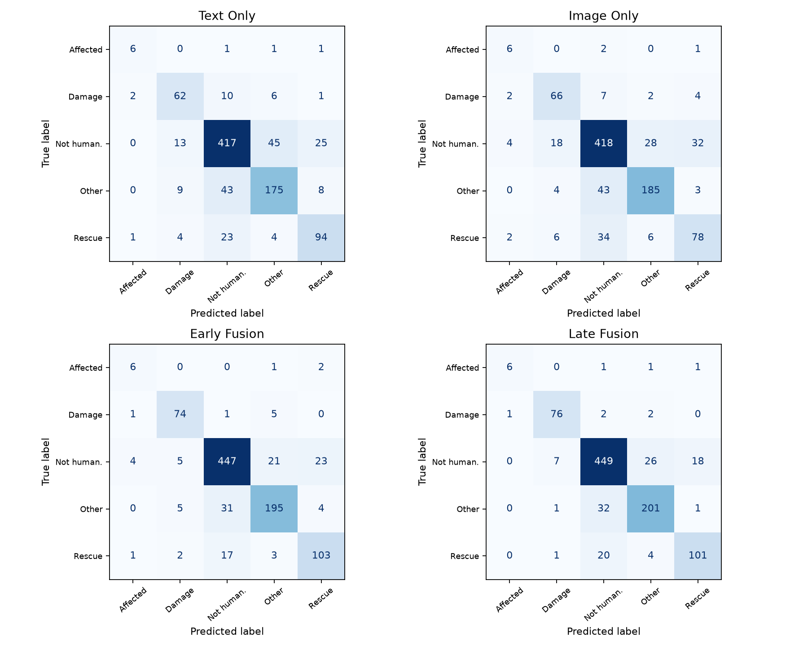

# Experimental Results

## 1. Overview

This project investigates whether combining text and image features improves five-class humanitarian classification on the CrisisMMD dataset.

Four approaches were compared:

1. Text-only classification using frozen BERT features.
2. Image-only classification using frozen EfficientNet-B0 features.
3. Early fusion by concatenating text and image features.
4. Late fusion by combining probabilities from separate text and image classifiers.

Model configurations were selected using development macro-F1. The final comparison uses the cleaned test split containing 951 samples.

## 2. Dataset Preparation

The original agreed-label humanitarian dataset contained 8,079 samples.

| Split | Original | Cleaned |
|---|---:|---:|
| Train | 6,126 | 6,093 |
| Development | 998 | 994 |
| Test | 955 | 951 |
| **Total** | **8,079** | **8,038** |

Data cleaning excluded:

- 18 visually confirmed placeholder images.
- 23 additional records involved in exact-pixel overlap between splits.

Exact-pixel duplicates were checked using decoded RGB image pixels. When duplicates crossed splits, the higher-priority split was retained (test > development > train).

A total of 219 ambiguous cross-split pHash candidate pairs remained. These were not automatically removed because perceptual similarity alone does not establish exact duplication.

No humanitarian labels were modified.

## 3. Experimental Setup

The pretrained encoders were used as frozen feature extractors:

- BERT: 768-dimensional text features.
- EfficientNet-B0: 1,280-dimensional image features.

Features were standardised using statistics fitted only on the training split.

Each trained classifier used:

- One hidden layer with 128 units.
- ReLU activation.
- Dropout.
- Five output classes.
- Adam optimiser with weight decay of 0.0001.
- Class-weighted cross-entropy loss.
- Batch size of 128.
- Maximum of 35 epochs.
- Early stopping patience of 6 epochs.
- Random seed 42.
- CPU training.

Early fusion concatenated the text and image features into a 2,048-dimensional input.

Late fusion combined the text-only and image-only prediction probabilities. The text probability weight was selected on the development set.

The main model-selection metric was macro-F1 because the five classes were imbalanced.

## 4. Hyperparameter Experiments

Six combinations of dropout and learning rate were evaluated.

The results below are development macro-F1 scores from each model's best checkpoint. Numbers in parentheses indicate the selected epoch.

| Exp | Dropout | Learning rate | Text-only | Image-only | Early fusion | Late fusion |
|---|---:|---:|---:|---:|---:|---:|
| E1 | 0.3 | 0.001 | 0.7046 (4) | 0.6421 (2) | 0.7868 (11) | 0.7760 |
| E2 | 0.3 | 0.0003 | 0.7116 (13) | 0.6528 (6) | 0.7742 (12) | 0.7819 |
| E3 | 0.3 | 0.003 | 0.7092 (11) | 0.6692 (4) | 0.7812 (5) | 0.7630 |
| E4 | 0.5 | 0.001 | 0.7067 (9) | 0.6322 (2) | 0.7864 (3) | 0.7896 |
| E5 | 0.5 | 0.0003 | 0.7198 (20) | 0.6341 (8) | 0.7517 (5) | 0.7733 |
| E6 | 0.5 | 0.003 | 0.7014 (10) | 0.6468 (11) | 0.7933 (5) | 0.7645 |

Late fusion has no separate training epoch because it combines the best checkpoints of its two unimodal classifiers.

The highest development macro-F1 for each approach determined the selected configuration:

| Approach | Selected experiment | Development macro-F1 |
|---|---|---:|
| Text-only | E5 | 0.7198 |
| Image-only | E3 | 0.6692 |
| Early fusion | E6 | 0.7933 |
| Late fusion | E4 | 0.7896 |

Late fusion E4 used the text and image checkpoints trained under E4, combined with a text weight of 0.50 and image weight of 0.50. It did not combine the separately tuned E5 and E3 classifiers.

These experiments used one random seed, so differences between configurations may be affected by training variability.

## 5. Overfitting Analysis

Several models achieved substantially higher training macro-F1 than development macro-F1.

For example, the selected E6 early-fusion checkpoint achieved:

- Training macro-F1: 0.9732.
- Development macro-F1: 0.7933.
- Best epoch: 5.

The train-development difference was approximately 0.180.

This suggests overfitting, although development macro-F1 remained considerably higher for fusion than for either unimodal baseline.

Increasing dropout did not consistently improve performance. At learning rate 0.001, early-fusion macro-F1 was 0.7868 with dropout 0.3 and 0.7864 with dropout 0.5. At learning rate 0.003, early fusion achieved 0.7933 with dropout 0.5.

The training curves show that validation loss sometimes increased while training loss continued decreasing. Early stopping based on development macro-F1 limited training and restored the best recorded checkpoint.

### Learning Curves

## 6. Test Results

The selected configurations were evaluated on the same 951 cleaned test samples.

| Approach | Test accuracy | Test macro-F1 | Weighted F1 |
|---|---:|---:|---:|
| Text-only (E5) | 0.7929 | 0.7456 | 0.7932 |
| Image-only (E3) | 0.7918 | 0.7119 | 0.7922 |
| Early fusion (E6) | 0.8675 | 0.8003 | 0.8681 |
| **Late fusion (E4)** | **0.8759** | **0.8470** | **0.8755** |

Late fusion achieved the highest observed test macro-F1.

Compared with the strongest selected unimodal baseline (text-only), late fusion improved macro-F1 by approximately 0.1015, or 10.15 percentage points.

Early fusion improved macro-F1 by approximately 0.0548 compared with text-only.

The test ranking was different from the development ranking. Early fusion performed slightly better on development, while late fusion performed better on test. The small development difference did not guarantee the same ranking on test.

## 7. Per-Class Performance

Test F1 scores for the two fusion approaches were:

| Class | Support | Early fusion | Late fusion |
|---|---:|---:|---:|
| Affected individuals | 9 | 0.5714 | 0.7500 |
| Infrastructure and utility damage | 81 | 0.8862 | 0.9157 |
| Not humanitarian | 500 | 0.8976 | 0.8944 |
| Other relevant information | 235 | 0.8478 | 0.8571 |
| Rescue, volunteering or donation effort | 126 | 0.7985 | 0.8178 |

Late fusion performed well on infrastructure damage and other relevant information.

The affected-individuals category was particularly difficult to evaluate reliably because it contained only nine test examples.

Late fusion correctly identified six of these nine examples. Its precision was 0.8571 and recall was 0.6667. Early fusion also correctly identified six, but produced more false positives.

This matters for humanitarian applications because false positives and missed urgent cases may have different operational consequences.

### Confusion Matrices

One recurring error was confusion between "not humanitarian" and "other relevant information". Such mistakes indicate that some posts contain information whose humanitarian relevance is not straightforward to infer from their text and image features.

## 8. Statistical Comparison

A class-stratified paired bootstrap with 2,000 repetitions was used to estimate 95% confidence intervals for test macro-F1.

| Approach | Macro-F1 | 95% bootstrap CI |
|---|---:|---|
| Text-only | 0.7456 | [0.6854, 0.7995] |
| Image-only | 0.7119 | [0.6570, 0.7650] |
| Early fusion | 0.8003 | [0.7437, 0.8540] |
| Late fusion | 0.8470 | [0.7832, 0.8915] |

Paired macro-F1 differences were:

| Comparison | Difference | 95% CI |
|---|---:|---|
| Early fusion - text-only | +0.0548 | [-0.0051, 0.1148] |
| Early fusion - image-only | +0.0884 | [0.0187, 0.1594] |
| Late fusion - text-only | +0.1015 | [0.0445, 0.1546] |
| Late fusion - image-only | +0.1351 | [0.0539, 0.2052] |
| Early fusion - late fusion | -0.0467 | [-0.1008, 0.0141] |

The confidence interval for late fusion minus text-only excludes zero, supporting an improvement on this evaluated test sample.

The interval for early fusion minus late fusion includes zero. Therefore, the observed advantage of late fusion over early fusion is not statistically conclusive.

Exact McNemar tests were also applied to paired classification accuracy:

- Early fusion versus text-only: p = 2.25e-9.
- Late fusion versus text-only: p = 2.79e-14.
- Early fusion versus late fusion: p = 0.422.

These are unadjusted p-values. McNemar's test addresses differences in paired classification errors, not macro-F1.

The bootstrap analysis treats rows as independent and does not account for event-level clustering or residual near-duplicates.

## 9. Performance Across Disaster Events

Late-fusion performance varied by event.

| Event | Test samples | Late-fusion macro-F1 |
|---|---:|---:|
| California wildfires | 78 | 0.7940 |
| Hurricane Harvey | 246 | 0.8693 |
| Hurricane Irma | 215 | 0.6582 |
| Hurricane Maria | 230 | 0.8462 |
| Iraq-Iran earthquake | 23 | 0.7474 |
| Mexico earthquake | 79 | 0.7603 |
| Sri Lanka floods | 80 | 1.0000 |

Event-level macro-F1 was calculated over the true classes present in each event, so it is not directly identical to overall five-class macro-F1.

The lower score on Hurricane Irma shows that strong overall performance does not guarantee equally strong results across disasters.

The perfect score for Sri Lanka floods should not be interpreted as proof of perfect generalisation. It reflects performance on this particular subset of 80 examples.

This analysis is descriptive. It is not a leave-one-event-out or unseen-event evaluation.

## 10. Near-Duplicate Sensitivity Analysis

There were 219 unresolved cross-split pHash candidate pairs after conservative cleaning.

Of the 951 cleaned test samples, 41 images were flagged as potentially similar to images in another split.

The following macro-F1 scores were obtained after excluding these 41 test samples:

| Approach | Full test (951) | Unflagged subset (910) |
|---|---:|---:|
| Text-only | 0.7456 | 0.7455 |
| Image-only | 0.7119 | 0.7109 |
| Early fusion | 0.8003 | 0.7989 |
| Late fusion | 0.8470 | 0.8474 |

Late fusion performance changed very little in this exploratory check.

However, this does not establish that the dataset is completely free from visual leakage. A more thorough image review or an independently collected test set would provide stronger evidence.

## 11. Ethical Considerations and Limitations

Several limitations should be considered:

- **Class imbalance:** affected individuals had only nine test examples.
- **Residual duplicate risk:** some visually similar images remained across splits.
- **Event dependence:** samples from the same disaster may share context and visual patterns.
- **Single-seed tuning:** the hyperparameter experiments used seed 42.
- **Limited interpretability:** the classifiers do not explain which image regions or words determined a prediction.
- **Frozen representations:** BERT and EfficientNet-B0 were not fine-tuned end-to-end.
- **Operational risk:** false negatives in urgent humanitarian classes could cause important information to be missed.
- **Test reuse:** this test split was previously inspected during an earlier project run, so the evaluation should not be described as a fully untouched blind test.

The final implementation did not include the additional image encoders, token-level cross-attention, or unseen-event testing considered in the proposal. Those would require additional computational and experimental work.

The reported inference timings also should not be interpreted as full end-to-end processing times because feature extraction was performed beforehand.

## 12. Conclusion

Both multimodal approaches outperformed the independently tuned text-only and image-only baselines in observed test macro-F1.

Late fusion achieved the highest test macro-F1 of 0.8470 and accuracy of 0.8759. Its macro-F1 improvement over the strongest unimodal baseline was supported by the paired bootstrap confidence interval.

However, late fusion's advantage over early fusion was not statistically conclusive.

The results suggest that combining text and image features can improve humanitarian classification, while class imbalance, potential visual leakage, and event-specific performance differences remain important limitations.

## 13. Reproducibility

The scripts used in this project are:

- `crisismmd_audit.py`
- `visual_review.py`
- `prepare_clean_splits.py`
- `train_models.py`
- `evaluate_models.py`

Aggregate results are stored in:

- `results/data_quality/cleaning_summary.json`
- `results/experiments/<experiment_name>/dev_results.json`
- `results/evaluation/test_results.json`

Training curves and confusion matrices are stored in `figures/`.

Original images, tweet data, cached feature files, model checkpoints, and sample-level predictions are not included in the public-facing results documentation.

Running training requires the group's pretrained feature cache in addition to the cleaned dataset.
